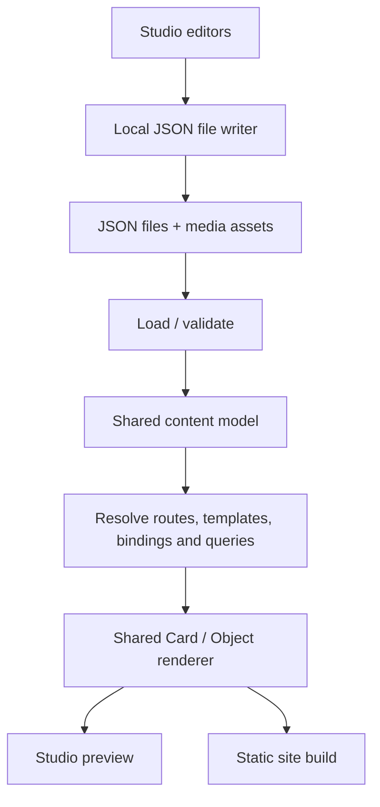

# Architecture — current model and intended data flow

## Product boundary

There are two connected products:
1. **Content Studio**, a local-first visual authoring environment.
2. **Public website**, a static set of pages generated from the same authored JSON data.

The existing `prototype-v2/index.html` is a self-contained functional editor **prototype**, not the actual static-site generator. It holds content in browser localStorage and previews HTML internally. The deployed website output, local JSON write service and real media directory are not yet implemented.

## Single data flow

The renderer should be shared or at minimum consume exactly the same rendering components, bindings and tests. Preview and static output must not diverge.

## Prototype data
The existing in-browser model conceptually contains:
- `site`: global metadata
- `collections[]`: schema/fields, records, base path, default template and optional per-format mappings
- `pages[]`: bespoke JSON-composed pages
- `templates[]`: reusable block trees attached to collection pages
- `components[]`: reusable block trees
- `assets[]`: image metadata and references

Existing defaults: `projects` → `/work/<slug>/` using project-detail; `posts` → `/posts/<slug>/` using Post format templates (Note, News, Article). New collections should be able to define their own base path and template without new hardcoded routing branches.

Use a few content files, e.g. `content/pages.json`, `content/projects.json`, `content/posts.json`, `content/assets.json`, `content/templates.json`, `content/components.json`, `content/settings.json`. These paths are a suggested partition, not a requirement.

## Composition
- **Card**: structural container, recursive, handles responsive layout and styling.
- **Object**: atomic content payload (text/image/graphic/empty).
- **Component**: reusable composition tree; specific instances may bind context/props.
- **Template**: page composition applied to a collection record.
- **Query/feed**: resolve a collection with explicit filter/sort/count and render items through reusable components.
- **Binding**: semantic property lookup (e.g. title/cover/body) from the current record, without arbitrary code evaluation.

The special root Card composes the page. Custom SVG/JS components remain an escape hatch where genuinely needed.

## File write boundary
Use a minimal local service (or equivalent explicit file permission mechanism). Ordinary web pages cannot silently overwrite arbitrary local files. Writes should be limited to allowed content/media paths, checked for duplicate IDs and slugs, validated before atomic replace, and disabled in the static deployment.

## Asset and publishing requirements
Media lives separately from JSON; the editor's asset metadata can refer to external or local media paths. Generate tangible `dist/**/index.html` pages supporting direct navigation and refresh. Respect unpublished records, route collisions, missing bindings/assets and output escaping. Do not copy demo content into factual public portfolio claims.
