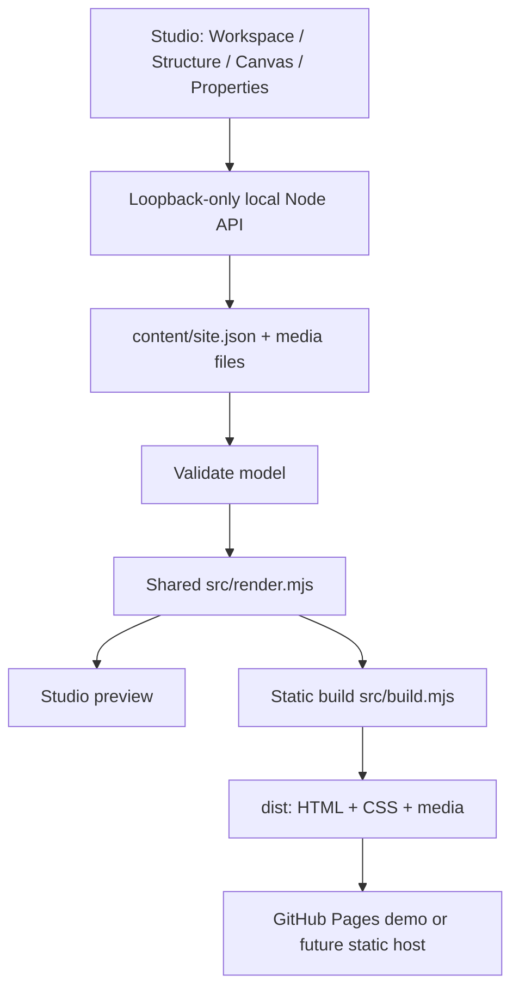

# Architecture — implemented system

This document describes the **working system**. See [the living implementation plan](IMPLEMENTATION_PLAN.md) for current milestone state and [dated logs](logs/README.md) for history. The preserved `prototype-v2/index.html` is a historical browser-local reference, **not** the current source of truth.

## Two products and one data model

1. **Content Studio** is a desktop-oriented browser UI served locally from `studio/index.html`. It connects to `src/server.mjs`, which binds only to `127.0.0.1`, validates edits and atomically persists `content/site.json`. Image uploads have a separate validated file pipeline.
2. **Public website** is generated static HTML/CSS/media under `dist/`. GitHub Actions builds/publishes that directory on merges to `main`. The **writable API and authoring editor are not deployed**. Project/post routes can load independently and refresh.

## Source format

A single pragmatic `content/site.json` currently stores:
- `site`: metadata, navigation, page-width-scaled design tokens and optional semantic frame constraints
- `collections[]`: schema, base paths, record data, default templates/format mappings
- `pages[]`: bespoke Home, Work, Journal and additional page composition
- `templates[]`: reusable record page compositions
- `components[]`: reusable Card/Item subtrees and record Card templates
- `assets[]`: binary file references, alt text, credits and other metadata

The source may be split into a few broad JSON files later, **only when operationally useful**. Do not implement one-file-per-record or a parallel Markdown content store by default.

## Graphic model

The **only authored graphical node kinds are Cards and Items**:
- **Card:** recursive equal-division grid with integer `columns` and `rows`, per-Card 1×/2×/4× gap and padding, palette background, optional outline and an optional section height constraint. Cards may contain Cards and atomic Items; data-driven collections are source Cards generating linked record Cards.
- **Item:** one atomic payload (text, rich text, image, link, etc.); no nested graphic authoring tree.
- **Area:** each child stores `area: {x1,y1,x2,y2}`, using 1-based, start-inclusive/end-exclusive grid-line positions in its parent Card.
- **Semantics:** Page is a master Card; header/nav, main, section, footer are semantic Cards. Incidental HTML nodes for payload internals do not become a separate graphical Block type.
- **Sizing:** `u = page width / 100` (`1cqw`). The design is **nonadaptive**: column counts and explicit areas do not change with device breakpoints. Narrow viewports scale/zoom like a print page. All public backgrounds are grayscale or transparent.
- **Overflow:** Items clip by default; optional internal scrolling hides the scrollbar while permitting normal document scroll chaining.

See [print grid](M7_PRINT_GRID.md) and [Card/Item DOM](M7_CARD_ITEM_DOM.md) for detailed CSS/geometry contracts.

## Local editor (M8 in progress)

The structure-first Studio branch uses four regions: **Workspace | Document Structure | Canvas | Properties**. The tree is the canonical JSON hierarchy; the canvas selects/previews; the property panel edits style tokens and atomic grid areas. Editor-only blue hover/selection is not part of public styling. Reordering tree children changes hierarchy/reading order, **not** their explicit cell positions; reparenting places moved children in valid target Card cells. Implemented and outstanding interactions are tracked in [M8 design](M8_EDITOR_PLAN.md) and the [living plan](IMPLEMENTATION_PLAN.md).

## Renderer and static routes

`src/render.mjs` is shared by browser and Node rendering paths. It resolves templates, bound fields (e.g. `{{title}}`), repeated records, Card references and route paths without evaluating arbitrary user JavaScript. Preview and generated HTML are parity-tested.

Published routes include `/`, `/work/`, `/posts/`, `/work/<slug>/`, `/posts/<slug>/` and generated `404.html`; unpublished draft records/routes remain excluded. The local Studio is separate from the static site. Current approved demonstration content is **not ready**, so generated pages stay `noindex`.

GitHub Pages currently publishes a project subpath and uses a build-time `TA_BASE_PATH` rewrite. A root-path build can later deploy to Hostinger or a comparable static host without making GitHub the asset host. Only the **built output** is deployed.

## Safety and operational boundaries

- The Node authoring API is local/loopback-only, with origin checks, validated JSON paths/IDs/slugs and atomic replacement. It is **not** multi-user or safe for simultaneous conflicting tabs.
- Media uploads are accepted only for validated image formats/sizes and written to approved asset locations; keep binaries and JSON metadata together in Git/backup workflows.
- Do not introduce remote write endpoints, arbitrary file writes or unescaped HTML injection.
- Preserve clear distinction between **prototype demo deployed** and **production site launched**: real copy, SEO, backups, accessibility and launch acceptance are future milestones.

## How changes ship

Continue implementation on the **single retained V1 development branch across M8–M11**. Run automated/browser checks and update the [living plan](IMPLEMENTATION_PLAN.md) plus [dated logs](logs/README.md) per cycle. **Do not merge or deploy at individual milestones.** After complete V1 user approval, perform exactly one squash merge to `main`; keep the original branch. For M12–M17, use one separate retained post-V1 branch and one final user-approved squash merge. **Never delete branches.** See [AGENTS.md](../AGENTS.md) for binding operational rules.
